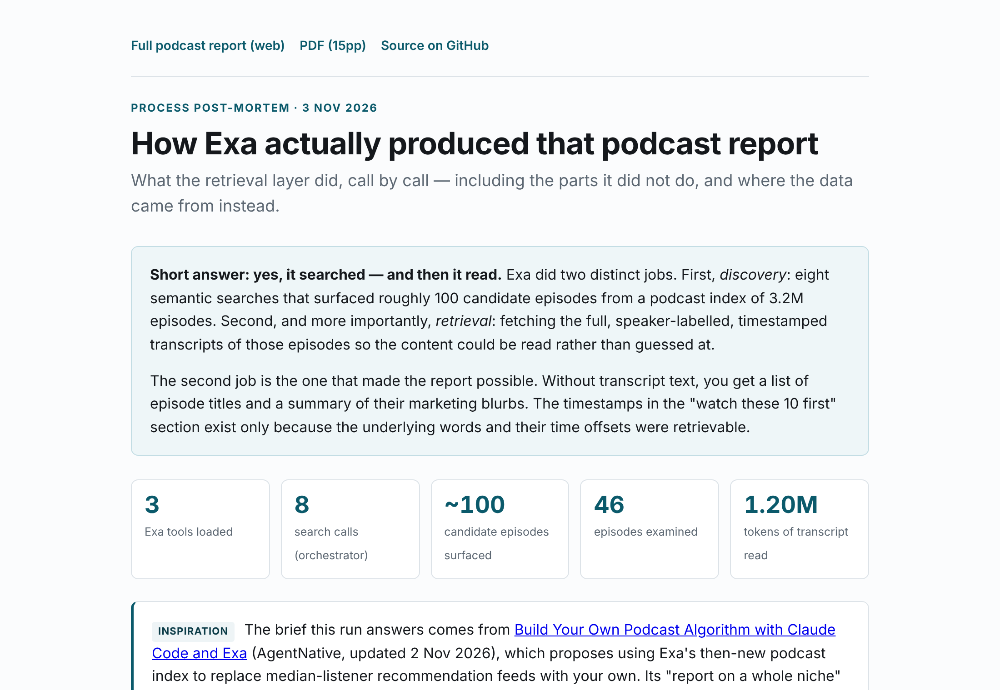

# AI in Medicine, Pharmacology & Drug Development — a podcast-derived niche report

A machine-read survey of what people actually **said out loud** about AI in drug discovery,
clinical development and clinical medicine, across podcast episodes published
**3 August – 3 November 2026**.

Roughly 100 candidate episodes were surfaced by semantic search; 46 were examined and
~1.2M tokens of transcript were read. The output is a 15-page report covering the dominant
themes, the live disagreements, the recurring companies and people, and a ranked
"watch these 10 first" list with jump-to timestamps.

### ▶ [Read it live →](https://az9713.github.io/claude-exa-podcast-report/)

[](https://az9713.github.io/claude-exa-podcast-report/)

---

## What's here

| Path | What it is |
|---|---|
| [`docs/index.html`](https://az9713.github.io/claude-exa-podcast-report/) | **Process post-mortem** — what the retrieval layer did, call by call, including what it got wrong |
| [`docs/report.html`](https://az9713.github.io/claude-exa-podcast-report/report.html) | **The full report** as a web page |
| [`docs/AI-in-Medicine-Podcast-Report-Nov2026.pdf`](https://az9713.github.io/claude-exa-podcast-report/AI-in-Medicine-Podcast-Report-Nov2026.pdf) | Same report, 15pp PDF, 47 clickable + printed source URLs |

## How it was built

```
ToolSearch ──▶ load Exa tool schemas
     │
     ▼
web_search_exa × 8  ──▶  ~100 candidate episodes
     │                   (title, URL, date, hosts/guests, highlights)
     ▼
manual triage  ──▶  filter to the 3-month window, dedupe, split into 4 themes
     │
     ▼
4 parallel reader agents ──▶ web_fetch_exa @ 60k chars/fetch
     │                       ~1.2M tokens of transcript consumed
     ▼
structured notes (claims + timestamps + quotes + scores)
     │
     ▼
synthesis ──▶ HTML ──▶ headless Chromium ──▶ PDF
```

The enabling capability is Exa's podcast index, shipped **29 October 2026**: 3.2M episodes
from 119k shows with full transcripts, speaker labels and time offsets. The timestamps in the
report exist because the underlying words and their offsets were retrievable — without
transcript text you get episode titles and marketing blurbs.

`agent_run` (Exa's autonomous research agent) was deliberately **not** used on this pass, so
that raw transcript stayed in view and partial coverage, synthetic shows and ASR errors could
be caught. The post-mortem argues it *is* the right tool for a recurring refresh.

## What the report found, in five lines

- **The consensus moved downstream.** Operators agree AI made *discovery* faster and cheaper
  (~80% fewer compounds, 50–70% less time to candidate at one company) while *clinical*
  success rates sit unchanged; approvals are flat at ~40–50/yr.
- **Data, not models, is the scarce input.** The most technical guests argue public
  biochemical data is largely "exhaust" and that measurement is the real bottleneck.
- **Agents are the new unit of work** — lab-in-the-loop AI scientists, agent skill toolkits,
  and evals scored against physically measured ground truth.
- **In the clinic the frontier is evidence and safety engineering, not model IQ.** One
  randomised trial (RECTIFIER, *JAMA*) showed +84% trial enrollment; scribe time savings are
  real but patient-outcome benefit is mostly unproven.
- **Regulation is moving and thin.** A first FDA Deputy Commissioner for Technology & AI, a
  generative-AI device framework, an Expedited IND pilot — and practitioners still calling the
  AI drug-development guidance "thin".

## Caveats

Read these before citing anything.

- Many figures are **company-reported and unaudited**; the report flags them.
- Transcripts are **machine-generated**, so proper nouns garble (Exscientia → "Accenture",
  Xaira → "Zera"). Entity normalisation was manual and is imperfect.
- Several episodes were only **partially retrievable** behind paywalls; affected claims are
  marked unverified.
- One recurring "show" in the corpus is **entirely AI-narrated with synthetic speakers**. It is
  demoted to secondary corroboration, but it is indistinguishable from a real interview in
  search results — a general hazard for anyone mining this index.
- Date filtering was **not** done by the search tool (no date parameter on the MCP surface) but
  by hand from publish fields.
- Nothing here is investment or medical advice.

## Enabling the live site

Pages is served from `main` → `/docs`. If the link above 404s, Pages has not been switched on
yet — **Settings → Pages → Source: "Deploy from a branch" → Branch: `main`, folder: `/docs` → Save**.
It goes live about a minute later at
`https://az9713.github.io/claude-exa-podcast-report/`. No build step or workflow is required;
the `docs/` folder is plain static HTML.

## Inspiration

This exists because of
**[Build Your Own Podcast Algorithm with Claude Code and Exa](https://agentnative.inc/resources/build-your-own-podcast-algorithm)**
(AgentNative, updated 2 Nov 2026), which makes the case for replacing median-listener
recommendation feeds with a search-and-read loop you control. Its *"report on a whole niche"*
prompt is the one run here, with AI in medicine, pharmacology and drug development substituted
for the original's AI-at-work niche.

## Reproducing it

Needs the Exa connector enabled in Claude, then roughly:

> Use Exa to search podcasts about `[your niche]` from the last 3 months. Read as many episode
> transcripts as you can. Then write me a PDF report on what's going on in this niche: the big
> themes, what people disagree on, the companies and people that keep coming up, and the 10
> episodes I should watch first, with timestamps.

## Licence & attribution

Report text and analysis: CC BY 4.0. All quoted material, episode titles and transcript
excerpts remain the property of their respective podcast publishers and are used here for
commentary and criticism, with every source linked. Quotations are kept short and every claim
is attributed to a named speaker, episode and timestamp.
